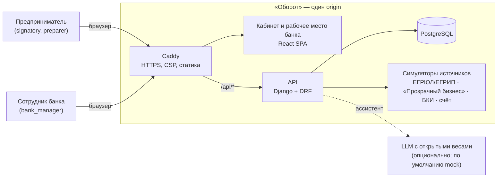
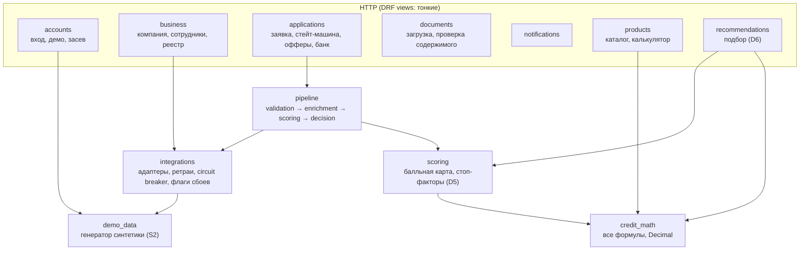
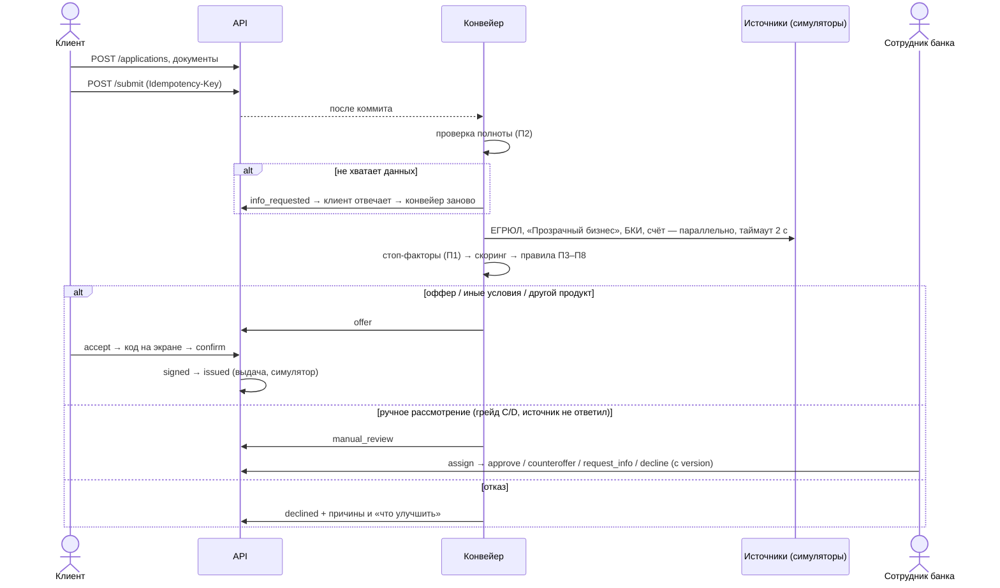
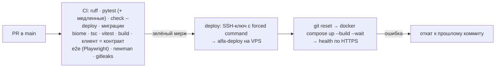

# Архитектура

«Оборот» — кредитный кабинет предпринимателя и рабочее место банка над одной и той же заявкой (кейс, T7). Здесь — из чего система состоит, как через неё проходит заявка, где она работает и почему устроена так. Связанные документы: API — [api.md](api.md) и [openapi.yaml](openapi.yaml), статусы — [state-machine.md](state-machine.md), сущности — [data-model.md](data-model.md), модель решения — [decision-model.md](decision-model.md), безопасность — [security.md](security.md), решения — [decisions.md](decisions.md).

## 1. Контекст

Ограничения кейса задают форму: только веб; ни email, ни SMS (код подписи — на экране, уведомления — в кабинете); все внешние источники — симуляторы; LLM — только с открытыми весами; всё поднимается из чистого клона без платных ключей.

## 2. Контейнеры

| Сервис | Что | Dev (`docker-compose.yml`) | Стенд (`docker-compose.prod.yml`) |
|---|---|---|---|
| `db` | PostgreSQL 18 | ✓ | ✓ |
| `backend` | Django + DRF: миграции → `seed_demo` → runserver / gunicorn (3 воркера) | ✓ :8000 | ✓ |
| `web` / `caddy` | один образ (`deploy/caddy`): собранный SPA + прокси `/api/*` на бэкенд + `/api/docs` на Swagger; на стенде — HTTPS (Let's Encrypt), CSP, HSTS | ✓ :8080 (HTTP) | ✓ :443 |
| `swagger` | Swagger UI по `docs/openapi.yaml` на `/api/docs` | ✓ | ✓ |
| `mock` | Prism: мок API по контракту для фронта без бэкенда | профиль `mock` | — |

Из чистого клона: `cp .env.example .env && docker compose up -d --build` → кабинет на http://localhost:8080 с демо-персонами и живой очередью банка.

## 3. Бэкенд: модули

| Модуль | Отвечает за | Правило |
|---|---|---|
| `credit_math` | лимит овердрафта, аванс факторинга, аннуитет, DSCR, долг/EBITDA, max сумма по DSCR, агрегация выписки | **все формулы только здесь**; Decimal, ROUND_HALF_UP; нельзя посчитать — `None` и причина, не 0 |
| `scoring` | балльная карта, грейд A–E, стоп-факторы С1–С5, тексты причин | чистые функции без ORM; версии карты и политики (`model_version`, `policy_version`) |
| `recommendations` | потребность → продукт → сумма → ранжирование → `reasons` | «предварительная оценка», не решение |
| `applications` | заявка и её стейт-машина, события, офферы, подпись, действия банка, очередь, дашборд | статус меняет только сервис переходов (`transitions.py`); `available_actions` — из него же; optimistic locking по `version` |
| `pipeline` | проверка полноты → источники параллельно → скоринг → правила П3–П8 → исход | любая ошибка → заявка к сотруднику, не «висит» |
| `integrations` | ответы источников, ретраи, circuit breaker, таймаут, флаги сбоев (`DemoState` в БД) | один набор синтетики с реестром компании |
| `documents` | загрузка: размер, тип по сигнатуре, проверка содержимого (активный PDF, полиглоты), случайные имена, отдача вложением | сервер файлы не исполняет и не разбирает |
| `accounts` | сессии, регистрация, демо-персоны, `seed_demo`, демо-очередь, сброс | демо — только при `DEMO_MODE=1` |

Доступ: каждый запрос клиента ограничен его компанией (`access.py`), чужой id → 404; эндпоинты банка — только `bank_manager` (403 клиенту).

## 4. Жизненный цикл заявки

Статусы и роли — [state-machine.md](state-machine.md). Каждое изменение — событие в журнале заявки и уведомление клиенту в кабинете (F5): клиент видит, что сделал банк, без перезагрузки (опрос каждые 3–15 с).

## 5. Фронтенд

- React + TypeScript (strict), Vite, react-router; данные — TanStack Query; формы — react-hook-form + zod; дизайн-система «Оборот» (Tailwind + shadcn/Radix, `src/components`).
- Клиент API **генерируется** из контракта (`openapi-typescript` → `src/api/schema.d.ts`, `openapi-fetch`): поле, которого нет в контракте, не скомпилируется.
- Фичи — папками `src/features/<фича>/` (кабинет: подбор, мастер, заявки, подписание, компания, продукты, уведомления; банк: очередь, карточка с действиями, дашборд, демо-панель).
- Деньги приходят строками и форматируются без float в расчётах (`lib/format.ts`); кнопки — только по `available_actions`; тексты интерфейса — в `src/texts`.

## 6. Данные

Данных кейса нет (D9): единый детерминированный генератор (`apps/demo_data`) создаёт компании, людей, выписки за 18 месяцев, ответы реестра, БКИ и ФНС; калибровка балльной карты — на нём же (decision-model.md, D9). `seed_demo` при старте засевает каталог, 8 персон, сотрудника банка и 30 заявок популяции через настоящий конвейер — у банка сразу живая очередь. Всё помечено «демо».

## 7. Поставка

## 8. Ключевые решения

| Решение | Альтернативы | Почему так | Ограничения |
|---|---|---|---|
| Contract-first: `openapi.yaml` — источник истины (D2, D13) | код → схема (drf-spectacular) | пять человек с агентами пишут параллельно против одного контракта; фронт работает на моке до бэкенда; тесты ловят расхождения | контракт меняет только лид — узкое место |
| Монолит Django + DRF (D3) | микросервисы; FastAPI | одна транзакция на переход статуса и аудит; ORM, миграции, админка, сессии из коробки | масштаб — вертикальный |
| Сессии + CSRF на одном origin (D4) | JWT в localStorage, CORS | нет токенов в JS (XSS не уводит сессию), нет CORS | фронт и API обязаны жить на одном домене |
| Одна стейт-машина на клиента и банк (D13) | отдельные процессы | клиент и банк видят одну заявку; `available_actions` с сервера — фронт не дублирует правила | новый переход — правка сервиса и контракта |
| Все формулы в `credit_math`, Decimal (D5) | расчёты по месту | одна проверенная реализация, примеры из кейса — тестами; деньги без float | — |
| Конвейер в процессе после коммита отправки | Celery + Redis worker | на хакатонном стенде (3 ГБ ОЗУ) меньше движущихся частей; решение за ~50 мс; код уже оформлен задачами Celery — включается `CELERY_BROKER_URL` | отправка ждёт конвейер; первая после старта воркера ~2 с (прогрев синтетики) |
| Симуляторы внутри бэкенда, из того же генератора | отдельный сервис симуляторов (S1) | детерминированно по ИНН, без сети; реестр и источники согласованы | сбой источника — флаг в БД, а не настоящая сеть; HTTP-слой появится с S1 |
| Синтетические данные одним генератором (D9) | ручные фикстуры | персоны воспроизводят числа модели до копейки; калибровка грейдов на популяции | качество модели на реальных данных не доказано |
| Код подписи и уведомления на экране (O5) | SMS, email | запрет кейса | — |
| LLM: mock по умолчанию, open-weight через OpenAI-совместимый API или Ollama (D8) | облачные проприетарные модели | требование кейса; запуск без ключей | ассистент пока не реализован (S7, B8) |
