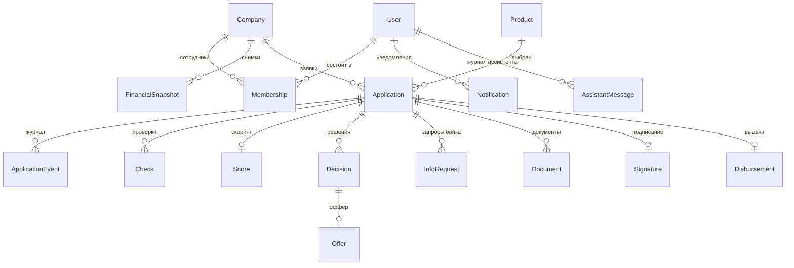

# Модель данных

Источник истины для моделей Django (L2). Имена — из [domain.md](domain.md); статусы и переходы — [state-machine.md](state-machine.md). Деньги — `Decimal(14,2)`, ставки и коэффициенты — `Decimal(8,4)`, время — UTC с таймзоной. Необязательное — `null`, а не 0 или пустая строка.

> v1, сверена с кейсом (docs/case.md). Уже в main (S3): `Business`, `Application`, `Document` — L2 доводит их до этой схемы **новыми** миграциями (стенд с автодеплоем, старые миграции не переписываем). `Business` переименована в `Company` (`RenameModel`); Django-приложение по-прежнему называется `business`. Тестовые данные — фабрики `apps/core/factories.py`.

## Пользователи и компании
**User** — стандартный пользователь Django + `UserProfile`:
- `kind`: `client` | `bank` — сторона; `full_name`; `is_demo`.
- Банк: роль `bank_manager` (все сотрудники банка в MVP — менеджеры). `admin` = `is_superuser`, только техническая админка.

**Company** (бывший `Business`)
- `legal_form`: `ip` | `ooo`; `name`, `inn` (уникальный), `ogrn`, `okved`, `okved_name`, `registered_at`, `region`, `address`
- `registry_status`: `active` | `liquidating` | `liquidated` — из ЕГРЮЛ; `liquidating`/`liquidated` — стоп-фактор (сценарий 6)
- `director_name`; `is_demo`; `created_at`
- Данные из ЕГРЮЛ заполняются один раз (автозаполнение по ИНН) и дальше переиспользуются — повторного ввода нет (C3).

**Membership** — пользователь в компании
- `user` → User, `company` → Company, `role`: `signatory` | `preparer`; `position` (должность текстом: «Генеральный директор», «Главный бухгалтер»…); уникальная пара (user, company)
- Права — [state-machine.md](state-machine.md#роли). Scoping клиента: все queryset — через `company__memberships__user = request.user`.

**FinancialSnapshot** — финансовый снимок компании за период
- `company`, `period` (YYYY-MM), `source`: `case` | `demo` | `simulator` | `manual`
- `cleaned_credit_turnover` (среднемесячный), `cfads`, `debt_service`, `revenue`, `cogs`, `ebitda`, `debt`, `cash`, `receivables`, `inventory`, `payables` — Money | null
- `counterparty_concentration`, `revenue_trend` — коэффициент | null

## Продукты
**Product** (каталог — D3, фикстура `backend/apps/products/fixtures/`)
- `code` (уникальный), `kind`: `overdraft` | `factoring` | `working_capital_loan` | `investment_loan` | `leasing`, `name`, `description`
- `rate_min`, `rate_max` (годовые, в долях); `term_min_months`, `term_max_months`; `amount_min`, `amount_max`
- `is_revolving`, `collateral_required`
- `params` (JSON: `alpha`, `beta`, `min_dscr`, `max_debt_to_ebitda`, `tranche_days`, …) — пороги живут здесь, не в коде
- `requirements` (JSON: `min_business_age_months`, `legal_forms`); `required_documents` (список DocumentKind)
- `is_active`

## Заявка и всё вокруг неё
**Application**
- `company` → Company; `created_by` → User
- `need_type`: `cash_gap` | `receivable_delay` | `working_capital` | `capex`; `purpose`
- `product` → Product | null; `requested_amount`; `term_months`; `invoice_amount` | null (факторинг: сумма отгрузки); `collateral_description` | null (залог, доп. условия)
- `status` — [state-machine.md](state-machine.md); **read-only** в API
- `version` (int, +1 на каждое изменение) — optimistic locking
- `assignee` → User (банк) | null
- `prefill_source`: `manual` | `recommendation` | `assistant`
- `source_unavailable` (bool) — хотя бы один источник не ответил (сценарий 7)
- `created_at`, `submitted_at`, `status_changed_at`, `decided_at` | null

**IdempotencyKey** — `key` (UUID), `user`, `endpoint`, `response_status`, `response_body`, `created_at`; уникальная пара (user, key). Повтор `submit` с тем же ключом отдаёт сохранённый ответ.

**ApplicationEvent** — журнал аудита (append-only)
- `application`, `kind`: `status_changed` | `document_uploaded` | `info_requested` | `info_responded` | `assigned` | `check_completed` | `score_calculated` | `decision` | `comment` | `signed` | `issued`
- `from_status`, `to_status` | null; `actor_kind`: `client` | `bank` | `system`; `actor` → User | null
- `message`; `payload` (JSON); `is_internal` (true — клиенту не показываем); `created_at`

**Check** — результат одного источника обогащения
- `application`, `source`: `egrul` | `transparent_business` | `bki` | `bank_account`
- `status`: `ok` | `warning` | `failed` | `unavailable`; `summary` (текст); `data` (JSON); `duration_ms`; `checked_at`

**Score** — `application` (1:1), `grade`: `A`–`E`, `total` (int), `factors` (JSON-список: `name`, `value`, `points`, `message`), `model_version`, `created_at`

**Decision** — каждое решение по заявке (авто или сотрудник)
- `application`, `outcome`: `offer` | `counteroffer` | `alternative_product` | `manual_review` | `info_requested` | `declined`
- `grade` (A–E | null) и `policy_version` — на что опиралось решение: скоринг ≠ решение (F8)
- `decided_by`: `auto` | `officer`; `officer` → User | null; `comment`
- `reasons` (JSON-список Reason: `metric`, `value`, `threshold`, `passed`, `message`); `improvements` (JSON-список строк «что улучшить» — для отказа)
- `created_at`

**Offer** — `decision` (1:1), `application`, `product` → Product, `amount`, `term_months`, `rate`, `monthly_payment` | null (возобновляемые — null), `requested_amount`, `is_counteroffer` (иные сумма/срок), `product_changed` (другой продукт), `status`: `active` | `accepted` | `declined` | `superseded`, `expires_at`, `created_at`. Активный оффер у заявки — максимум один.

**InfoRequest** — `application`, `origin`: `validation` (автопроверка полноты, F6) | `officer`; `requested_by` → User | null, `message`, `fields` (список полей для уточнения), `document_kinds` (список DocumentKind), `status`: `open` | `answered`, `response_message`, `answered_by` → User | null, `created_at`, `answered_at`

**Document** (есть, S3) — `application`, `kind` (DocumentKind, + `shipment_document` для УПД), `file` (случайное имя), `original_name`, `content_type` (по сигнатуре), `size`, `sha256`, `uploaded_by` → User, `info_request` → InfoRequest | null, `uploaded_at`

**Signature** — `application` (1:1), `code_hash` (код хранится только хешем; на экран — один раз), `expires_at`, `attempts_left`, `signed_at` | null, `signed_by` → User | null

**Disbursement** — `application` (1:1), `amount`, `account_masked`, `status`: `pending` | `done` | `failed`, `issued_at` | null

## Прочее
**Notification** — `user`, `application` | null, `kind` (как у события), `title`, `message`, `created_at`, `read_at` | null. Только в интерфейсе: ни email, ни SMS (чек-лист кейса).

**AssistantMessage** — журнал ассистента: `user`, `application` | null, `role`: `user` | `assistant` | `tool`, `content`, `tool_calls` (JSON: имя, аргументы, результат), `created_at`

**DemoState** (только стенд, `DEMO_MODE=1`) — флаги сбоев симуляторов: `source` → `failing` (bool).
