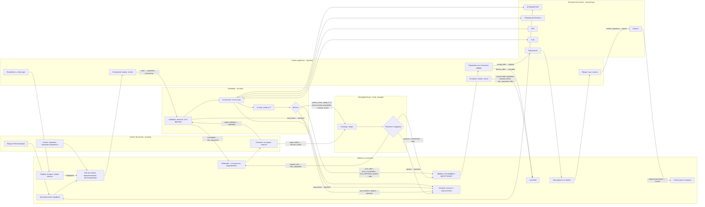

# Модель кредитного процесса

Закрывает F2: «Спроектируйте модель кредитного процесса: границы, этапы, действия участников, необходимые данные, возможные результаты» ([case.md](case.md)). Статусы и переходы — [state-machine.md](state-machine.md) (номера переходов ниже — оттуда), сущности и поля — [data-model.md](data-model.md), термины — [domain.md](domain.md). Что вошло в MVP и почему — [mvp.md](mvp.md).

## Границы
| | Что |
|---|---|
| Начало | У предпринимателя возникла потребность в деньгах (`need_type`: `cash_gap`, `receivable_delay`, `working_capital`, `capex`) — до выбора продукта и до заявки |
| Конец | Финальный статус заявки: `issued` (деньги выданы), `declined` (отказ с причинами), `cancelled` (клиент отозвал заявку или отклонил оффер) |
| Внутри | Подбор продукта и суммы, профиль компании, заявка, проверка полноты, обогащение из внешних источников, скоринг, решение (авто и сотрудник), запрос информации, оффер и контроффер, подписание, выдача |
| Вне | Обслуживание и погашение кредита, мониторинг ковенант, реструктуризация, взыскание; контакт банка с покупателем по факторингу; кредитный комитет и цепочка андеррайтер / риск-менеджер; реальные КЭП, SMS и платёжные системы |
| Внешние участники | ЕГРЮЛ/ЕГРИП, «Прозрачный бизнес», БКИ, банковский счёт, подписание, выдача — симуляторы с упрощёнными контрактами (O4, O6) |

## Участники (дорожки)
| Дорожка | Кто | В коде | Что делает |
|---|---|---|---|
| Клиент-директор | собственник, генеральный директор, уполномоченный | `signatory` | всё, что preparer, плюс отправляет, отзывает, принимает или отклоняет оффер, подписывает |
| Клиент-бухгалтер | бухгалтер, финансовый директор, сотрудник по финансированию | `preparer` | заполняет профиль и черновик, загружает документы, отвечает на запросы |
| Кабинет и ассистент | веб-кабинет `/app`, ИИ-ассистент | — | подбор, предзаполнение, статус и «что дальше», уведомления; ассистент действует от имени пользователя, отправку подтверждает человек, инструментов банка нет |
| Конвейер | система (worker) | `actor_kind=system` | validation → enrichment → scoring → decision |
| Внешние источники | симуляторы | `Check.source`, `Signature`, `Disbursement` | данные о компании, кредитной истории, счёте; код подписи; операция выдачи |
| Менеджер банка | сотрудник банка, `/bank` | `bank_manager` | очередь, карточка заявки, решение по нестандартным случаям |

## Swimlane

Отвечать на запрос может и `signatory`; на схеме ответ — у бухгалтера, потому что это его типичная работа (R05 в [research.md](research.md)).

## Этапы
| # | Этап | Кто действует | Входные данные | Что проверяется | Результат | Статус (переход) |
|---|---|---|---|---|---|---|
| 0 | Потребность и подбор | signatory или preparer; кабинет, ассистент | `need_type`, `purpose`, желаемая сумма и срок; `FinancialSnapshot` компании; `Product` (`params`, `requirements`) | стоп-факторы; условия продуктов (`min_business_age_months`, `legal_forms`); размер — `credit_math` (`overdraft_limit`, `factoring_advance`, `working_capital_need`, `max_loan_by_dscr`) | продукт, сумма, `reasons`; «предварительная оценка», не решение банка | — (заявки ещё нет) |
| 1 | Профиль компании | preparer или signatory; кабинет | `inn` → симулятор ЕГРЮЛ/ЕГРИП | существование и `registry_status` | `Company` (`name`, `ogrn`, `okved`, `address`, `director_name`, `registry_status`), `Membership` (`role`, `position`), `FinancialSnapshot` | — |
| 2 | Черновик | preparer или signatory; мастер заявки | `product`, `need_type`, `purpose`, `requested_amount`, `term_months`, `invoice_amount` (факторинг), `collateral_description`; документы из `Product.required_documents` | валидация полей формы; тип файла по содержимому, размер | `Application` (`prefill_source`), `Document` | `draft` |
| 3 | Отправка | signatory | черновик, `Idempotency-Key` | обязательные поля, роль; повтор с тем же ключом → тот же ответ | `submitted_at`, событие `status_changed`, уведомление | `draft → submitted` (1) |
| 4 | Приём и проверка полноты (validation) | конвейер | `Application`, `Company`, `Document` | полнота и корректность (F6); стоп-факторы по анкете | дальше по конвейеру или `InfoRequest(origin=validation, fields, document_kinds)` | `submitted → processing` (2); `→ info_requested` (4a); `→ declined` (3) |
| 5 | Обогащение (enrichment) | конвейер, симуляторы | `inn`, параметры заявки | ЕГРЮЛ/ЕГРИП — существование, статус, ОКВЭД; «Прозрачный бизнес» — руководители, учредители, адреса; БКИ — обязательства, просрочки; счёт — обороты, поток | `Check` × 4 (`ok` / `warning` / `failed` / `unavailable`), `source_unavailable`, событие `check_completed` | `processing`; стоп-фактор → `declined` (3) |
| 6 | Скоринг | конвейер (`apps/scoring`) | `FinancialSnapshot`, `Check`, параметры заявки | балльная карта по факторам | `Score` (`grade` A–E, `total`, `factors`, `model_version`), событие `score_calculated` | `processing` |
| 7 | Решение (авто) | конвейер | `grade`, продукт, сумма, срок, `Check`, `Product.params`; суммы — `credit_math` | правила decision-model.md (D4): DSCR, Debt/EBITDA, лимиты продукта; скоринг ≠ решение (F8) | `Decision` (`decided_by=auto`, `outcome`, `reasons`, `policy_version`), при оффере — `Offer` | `→ offer` (4), `→ manual_review` (5), `→ declined` (6) |
| 8 | Ручное рассмотрение | bank_manager | очередь; карточка: Заявка, Клиент, Проверки, Скоринг, Документы, Журнал | нестандартный случай: грейд в зоне ручного рассмотрения или недоступный источник | событие `assigned`; `Decision` (`decided_by=officer`, `comment`, `reasons`) | `manual_review → offer` (7), `→ info_requested` (8), `→ declined` (9) |
| 9 | Запрос информации и ответ | signatory или preparer | `InfoRequest`: `message`, `fields`, `document_kinds` | — | `response_message`, `Document` с `info_request`, событие `info_responded` | `info_requested → manual_review` (10) или `→ submitted` (10a) |
| 10 | Оффер | signatory | `Offer`: `amount`, `term_months`, `rate`, `monthly_payment`, `requested_amount`, `is_counteroffer`, `product_changed`; `reasons` решения | оффер `active` | `Offer.status`: `accepted` или `declined` | `offer → signing` (11) или `→ cancelled` (12) |
| 11 | Подписание | signatory; симулятор подписания | код на экране | код верный, не истёк, `attempts_left` | `Signature` (`signed_at`, `signed_by`), событие `signed` | `signing → signed` (13) |
| 12 | Выдача | система; симулятор выдачи | `Offer.amount`, счёт | — | `Disbursement` (`amount`, `account_masked`, `status=done`, `issued_at`), событие `issued` | `signed → issued` (14) |
| — | Отзыв | signatory | — | текущий статус: `draft`, `submitted`, `manual_review`, `info_requested`, `offer` | — | `→ cancelled` (15) |

Каждый переход проверяет статус, роль и `version`, пишет `ApplicationEvent` и, где указано в state-machine.md, `Notification`.

## Исходы
| Исход кейса | `Decision.outcome` | Кто решает | Статус | Что видит клиент | Что дальше |
|---|---|---|---|---|---|
| Одобрение | `offer` | конвейер (4) или сотрудник (7) | `offer` | сумма, срок, ставка, платёж, `reasons` | принять → подписание, или отклонить |
| Иные условия (сумма, срок) | `counteroffer` | конвейер (4) или сотрудник (7, комментарий обязателен) | `offer` | запрошенная и предложенная сумма (`requested_amount`, `is_counteroffer`), причина с метрикой и порогом (например, сумма > `max_loan_by_dscr`) | принять или отклонить |
| Другой продукт | `alternative_product` | конвейер (4) | `offer` | другой продукт (`product_changed`) и почему он лучше закрывает потребность | принять или отклонить |
| Запрос информации | `info_requested` | конвейер — проверка полноты (4a) или сотрудник (8) | `info_requested` | что уточнить: `fields`, `document_kinds`, `message` | ответить и загрузить документ → конвейер заново (10a) или к сотруднику (10) |
| Отказ | `declined` | конвейер: стоп-фактор (3) или грейд E (6); сотрудник (9, причины обязательны) | `declined` | `reasons` и `improvements` — «что улучшить» | финал |
| Ручное рассмотрение | `manual_review` | конвейер (5): грейд в зоне ручного рассмотрения или источник `unavailable` | `manual_review` | «Заявку смотрит сотрудник» | сотрудник: оффер, контроффер, запрос или отказ |
| Отзыв клиентом | — | signatory: `cancel` (15) или `decline_offer` (12) | `cancelled` | заявка отозвана | финал |

## Данные по ходу процесса
| Сущность | Где создаётся | Где переиспользуется |
|---|---|---|
| `Company`, `Membership` | этап 1 | подбор, мастер заявки (предзаполнение — F12), карточка банка «Клиент», стоп-фактор по `registry_status` |
| `FinancialSnapshot` | этап 1 (симулятор счёта, демо) | подбор (суммы), скоринг, решение |
| `Application`, `Document` | этапы 2–3 | все следующие этапы; `prefill_source` показывает, откуда пришли параметры (подбор, ассистент) |
| `InfoRequest` | этапы 4, 8 | ответ клиента (этап 9), карточка банка |
| `Check`, `Score` | этапы 5–6 | решение, вкладки «Проверки» и «Скоринг» у банка |
| `Decision`, `Offer` | этапы 7–8 | оффер клиенту, подписание, выдача |
| `Signature`, `Disbursement` | этапы 11–12 | таймлайн клиента, журнал |
| `ApplicationEvent`, `Notification` | на каждом переходе | таймлайн и уведомления клиента (только в интерфейсе — O5), вкладка «Журнал» банка; `is_internal` — клиенту не показываем |

## Сценарии 1–8
Сценарии — [plan.md](plan.md), персоны — [demo.md](demo.md), номера переходов — [state-machine.md](state-machine.md).

| # | Сценарий | Этапы | Переходы | Исход |
|---|---|---|---|---|
| 1 | Кофейня: `cash_gap` → овердрафт | 0–3, 4–7, 10–12 | 1 → 2 → 4 (оффер) → 11 → 13 → 14 | `issued` |
| 2 | Поставщик: `receivable_delay` → факторинг под отгрузку | 0–3, 4–7, 10–12 | 1 → 2 → 4 → 11 → 13 → 14 | `issued` |
| 3 | Сезонный магазин: `working_capital` → КПО, просит 5,3 млн | 0–3, 4–7, 10–12 | 1 → 2 → 4 (контроффер 2 009 314 ₽) → 11 → 13 → 14 | `counteroffer` → `issued` |
| 4 | Производство: `capex`, просрочка в БКИ; готовит бухгалтер, подписывает директор | 0–3, 4–7, 8, 9, 8, 10–12 | 1 → 2 → 5 (грейд C) → 8 → загрузка документа → 10 → 7 → 11 → 13 → 14 | `manual_review` → `info_requested` → `offer` → `issued` |
| 5 | Зависимый поставщик: концентрация 80%, выручка −20% | 0–3, 4–7 (или 8) | 1 → 2 → 6 (или 5 → 9) | `declined` с `improvements` |
| 6 | Компания в ликвидации | 0–3, 4–5 | 1 → 2 → 3 | `declined` по стоп-фактору |
| 7 | Сбой БКИ | 0–3, 4–7, 8 | 1 → 2 → 5 (источник `unavailable`) | `manual_review` с пометкой `source_unavailable` |
| 8 | Оборудование без залога: `capex` → инвест-кредит 12 млн, залога нет (D15) | 0–3, 4–7, 10–12 | 1 → 2 → 4 (другой продукт: лизинг 11 443 551 ₽) → 11 → 13 → 14 | `alternative_product` → `issued` |
