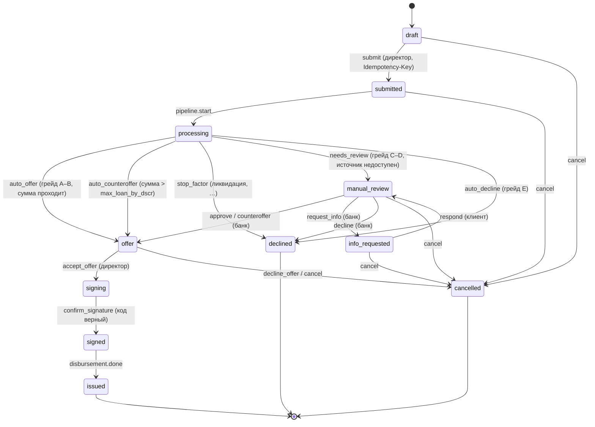

# Стейт-машина заявки

Одна стейт-машина на клиента и банк (plan.md, «Целостность важнее широты»). Статус меняется **только** функциями сервисного слоя (`backend/apps/applications/services.py`, L2): каждая проверяет текущий статус, роль и `version`, пишет `ApplicationEvent` (журнал аудита) и, где указано, `Notification`. Недопустимый переход → 409 `invalid_transition`; устаревшая `version` → 409 `version_conflict`.

> v1 по плану лида. Сверка с текстом кейса — после его получения (TODO L1).

## Статусы
| Статус | Что значит для клиента | Кто действует дальше |
|---|---|---|
| `draft` | Черновик: заполняете заявку | клиент |
| `submitted` | Заявка отправлена, скоро начнём проверку | система |
| `processing` | Идёт автоматическая проверка: реестры, БКИ, счёт, скоринг | система |
| `manual_review` | Заявку смотрит сотрудник банка | банк |
| `info_requested` | Банк просит уточнить данные или загрузить документ | клиент |
| `offer` | Есть предложение (или контрпредложение) — примите или откажитесь | клиент |
| `signing` | Подпишите договор кодом с экрана | клиент (директор) |
| `signed` | Договор подписан, деньги в пути | система |
| `issued` | Деньги выданы | — (финал) |
| `declined` | Отказ с причинами и советом, что улучшить | — (финал) |
| `cancelled` | Заявка отозвана клиентом | — (финал) |

## Диаграмма

## Переходы
| # | Из | В | Действие (API) | Кто | Условия | Событие → уведомление клиенту |
|---|---|---|---|---|---|---|
| 1 | draft | submitted | `submit` (POST …/submit) | клиент: director | обязательные поля заполнены; `Idempotency-Key`; повтор с тем же ключом → тот же ответ без нового перехода | `status_changed` → «Заявка отправлена» |
| 2 | submitted | processing | `pipeline.start` | система (worker) | — | `status_changed` |
| 3 | processing | declined | `stop_factor` | система | любой стоп-фактор в validation/enrichment | `decision` → «Отказ: …» |
| 4 | processing | offer | `auto_offer` / `auto_counteroffer` | система | грейд и правила decision-model.md (D4); контроффер — если запрошенная сумма > допустимой по DSCR | `decision` → «Готово предложение» |
| 5 | processing | manual_review | `needs_review` | система | грейд в зоне ручного рассмотрения **или** хотя бы один источник `unavailable` (сценарий 7) | `status_changed` → «Заявку смотрит сотрудник» |
| 6 | processing | declined | `auto_decline` | система | грейд E | `decision` → «Отказ: …» |
| 7 | manual_review | offer | `approve` / `counteroffer` (POST /api/bank/…/approve, …/counteroffer) | банк | `version`; комментарий обязателен для контроффера | `decision` → «Готово предложение» |
| 8 | manual_review | info_requested | `request_info` | банк | `version`; текст запроса | `info_requested` → «Банк просит документ» |
| 9 | manual_review | declined | `decline` | банк | `version`; причины обязательны | `decision` → «Отказ: …» |
| 10 | info_requested | manual_review | `respond` (POST …/info-requests/{id}/respond) | клиент: director, accountant | ответ на открытый запрос | `info_responded` (уведомление — банку, в очереди) |
| 11 | offer | signing | `accept_offer` | клиент: director | оффер `active` | `status_changed` |
| 12 | offer | cancelled | `decline_offer` | клиент: director | — | `status_changed` |
| 13 | signing | signed | `confirm_signature` | клиент: director | код верный, не истёк, попытки остались | `signed` → «Договор подписан» |
| 14 | signed | issued | `disbursement.done` | система (симулятор выдачи) | — | `issued` → «Деньги выданы» |
| 15 | draft, submitted, manual_review, info_requested, offer | cancelled | `cancel` | клиент: director | — | `status_changed` |

Не меняют статус, но пишутся в журнал: `document_uploaded`, `assigned` (банк взял заявку), `check_completed`, `score_calculated`, `comment` (внутренний комментарий банка — клиенту не виден).

## Роли
| Действие | director | accountant | bank_manager |
|---|---|---|---|
| Создать и редактировать черновик, загрузить документы | ✓ | ✓ | — |
| Отправить заявку, отозвать, принять или отклонить оффер, подписать | ✓ | — | — |
| Ответить на запрос информации | ✓ | ✓ | — |
| Видеть очередь, карточку, проверки, скоринг, журнал | — | — | ✓ |
| Взять заявку, одобрить, контроффер, запросить информацию, отказать | — | — | ✓ |

`admin` (Django superuser) — техническая админка, в продукте не участвует. Клиент видит только заявки своей компании; банк — все; чужой id → 404.

## `available_actions`
Каждый ответ с заявкой содержит `available_actions` — список действий, доступных **текущему пользователю** сейчас (по статусу и роли). Фронт рисует кнопки только по нему и не дублирует правила. Значения: `edit`, `upload_document`, `submit`, `cancel`, `respond_info`, `accept_offer`, `decline_offer`, `sign`, `assign`, `approve`, `counteroffer`, `request_info`, `decline`.

## Конвейер (L4)
`submitted` → worker: **validation** (полнота, стоп-факторы по анкете) → **enrichment** параллельно с таймаутами: ЕГРЮЛ/ЕГРИП, «Прозрачный бизнес», БКИ, счёт (адаптеры с ретраями и circuit breaker) → **scoring** (`apps/scoring`, грейд A–E) → **decision** (правила decision-model.md, суммы — `credit_math`). Источник недоступен → `Check.status = unavailable`, заявка уходит в `manual_review` с пометкой (сценарий 7), а не в отказ.

## Сценарии плана → переходы
| Сценарий | Путь |
|---|---|
| 1 Кофейня | 1 → 2 → 4 (оффер) → 11 → 13 → 14 |
| 2 Поставщик, факторинг | 1 → 2 → 4 → 11 → 13 → 14 |
| 3 Сезонный магазин | 1 → 2 → 4 (контроффер 2 009 314 ₽) → 11 → 13 → 14 |
| 4 Производство | 1 → 2 → 5 (грейд C) → 8 → загрузка документа → 10 → 7 → 11 → 13 → 14 |
| 5 Зависимый поставщик | 1 → 2 → 6 (или 5 → 9) с «что улучшить» |
| 6 Компания в ликвидации | 1 → 2 → 3 |
| 7 Сбой БКИ | 1 → 2 → 5 (источник `unavailable`) |
