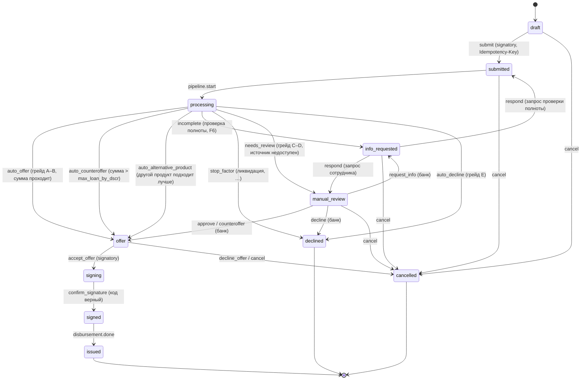

# Стейт-машина заявки

Одна стейт-машина на клиента и банк (plan.md, «Целостность важнее широты»). Статус меняется **только** функциями сервисного слоя (`backend/apps/applications/services.py`, L2): каждая проверяет текущий статус и роль, действия банка, правка черновика и `submit` — ещё и `version` (у `submit` поле необязательное для старых клиентов, кабинет передаёт всегда; действия клиента в `offer`/`signing` версию не требуют — в этих статусах заявку меняет только он сам), пишет `ApplicationEvent` (журнал аудита) и, где указано, `Notification`. Недопустимый переход → 409 `invalid_transition`; устаревшая `version` → 409 `version_conflict`.

> v1, сверена с кейсом: F5 (динамика статуса), F6 (проверка полноты → уточнение), F9 (небинарные исходы), F10 (оформление и выдача — смоделированы, O6).

## Статусы
| Статус | Что значит для клиента | Кто действует дальше |
|---|---|---|
| `draft` | Черновик: заполняете заявку | клиент |
| `submitted` | Заявка отправлена, скоро начнём проверку | система |
| `processing` | Идёт автоматическая проверка: реестры, БКИ, счёт, скоринг | система |
| `manual_review` | Заявку смотрит сотрудник банка | банк |
| `info_requested` | Банк просит уточнить данные или загрузить документ | клиент |
| `offer` | Есть предложение (или контрпредложение) — примите или откажитесь | клиент |
| `signing` | Подпишите договор кодом с экрана | клиент (signatory) |
| `signed` | Договор подписан, деньги в пути | система |
| `issued` | Деньги выданы | — (финал) |
| `declined` | Отказ с причинами и советом, что улучшить | — (финал) |
| `cancelled` | Заявка отозвана клиентом | — (финал) |

### Нормативы времени (SLA)
Норматив есть только у статусов, где ход за банком или системой: `submitted` — 1 ч, `processing` — 1 ч, `manual_review` — 24 ч, `signed` — 1 ч (`APPLICATION_SLA_HOURS`, `backend/apps/applications/sla.py`; переопределяется `SLA_HOURS` в .env, ошибочное значение оставляет нормативы по умолчанию с предупреждением в логе). У статусов, где ход за клиентом (`draft`, `info_requested`, `offer`, `signing`), и у финальных (`issued`, `declined`, `cancelled`) норматива нет: такие заявки не просрочены, сколько бы ни прошло времени. Отсчёт — от `status_changed_at`; просрочено, когда срок прошёл. Очередь отдаёт `sla_due_at`, `is_overdue`, `overdue_hours` и фильтр `overdue`, дашборд — `sla_hours`, `sla_open_count`, `overdue_count`, `overdue_share`; фронт своих порогов не держит (XP4, D24).

## Диаграмма

## Переходы
| # | Из | В | Действие (API) | Кто | Условия | Событие → уведомление клиенту |
|---|---|---|---|---|---|---|
| 1 | draft | submitted | `submit` (POST …/submit) | клиент: signatory | `version`, если передана (черновик, который видел подписант; иначе 409); поля, без которых банк не начнёт проверку, заполнены: продукт, цель от 10 символов, сумма и срок в границах продукта, сумма отгрузки у факторинга (иначе 400 по полю — после отправки поля не изменить; `apps/applications/completeness.py`); `Idempotency-Key`; повтор с тем же ключом → тот же ответ без нового перехода; согласие на запрос в БКИ (`bki_consent: true` и актуальная `consent_version`, иначе 400) — сохраняется как BkiConsent в той же транзакции (SRC1) | `consent_given` → «Согласие на запрос в БКИ», затем `status_changed` → «Заявка отправлена» |
| 2 | submitted | processing | `pipeline.start` | система (worker) | — | `status_changed` |
| 3 | processing | declined | `stop_factor` | система | любой стоп-фактор в validation/enrichment | `decision` → «Отказ: …» |
| 4 | processing | offer | `auto_offer` / `auto_counteroffer` / `auto_alternative_product` | система | грейд и правила decision-model.md (D4); контроффер — если запрошенная сумма или срок не проходят (например, сумма > max_loan_by_dscr); другой продукт — если он лучше закрывает потребность | `decision` → «Готово предложение» |
| 4a | processing | info_requested | `incomplete` | система | не хватает документов продукта: `InfoRequest(origin=validation, document_kinds=[…])`; поля проверены при `submit`, здесь остаются только как страховка для заявок, отправленных раньше. Клиент догружает документы и отвечает (10a) — петли нет | `info_requested` → «Уточните данные» |
| 5 | processing | manual_review | `needs_review` | система | грейд в зоне ручного рассмотрения **или** хотя бы один источник `unavailable` (сценарий 7) | `status_changed` → «Заявку смотрит сотрудник» |
| 6 | processing | declined | `auto_decline` | система | грейд E | `decision` → «Отказ: …» |
| 7 | manual_review | offer | `approve` / `counteroffer` (POST /api/bank/…/approve, …/counteroffer) | банк | `version`; комментарий обязателен для контроффера; сумма, срок и ставка — в границах продукта (иначе 400) | `decision` → «Готово предложение» |
| 8 | manual_review | info_requested | `request_info` | банк | `version`; текст запроса | `info_requested` → «Банк просит документ» |
| 9 | manual_review | declined | `decline` | банк | `version`; причины обязательны | `decision` → «Отказ: …» |
| 10 | info_requested | manual_review | `respond` (POST …/info-requests/{id}/respond) | клиент: signatory, preparer | ответ на запрос сотрудника (`origin=officer`) | `info_responded` (в очереди банка) |
| 10a | info_requested | submitted | `respond` | клиент: signatory, preparer | ответ на запрос проверки полноты (`origin=validation`) — конвейер запускается заново | `info_responded` |
| 11 | offer | signing | `accept_offer` | клиент: signatory | оффер `active` | `status_changed` |
| 12 | offer | cancelled | `decline_offer` | клиент: signatory | — | `status_changed` |
| 13 | signing | signed | `confirm_signature` | клиент: signatory | код верный, не истёк, попытки остались | `signed` → «Договор подписан» |
| 14 | signed | issued | `disbursement.done` | система (симулятор выдачи) | — | `issued` → «Деньги выданы» |
| 15 | draft, submitted, manual_review, info_requested, offer | cancelled | `cancel` | клиент: signatory | — | `status_changed` |

Исход решения (`Decision.outcome`): `offer`, `counteroffer` (иные сумма или срок), `alternative_product` (другой продукт), `manual_review`, `info_requested`, `declined` — все пять исходов кейса («одобрение, отказ, иные условия, другой продукт, запрос информации»). Решение хранит грейд скоринга и версию правил: скоринг ≠ решение (F8).

Не меняют статус, но пишутся в журнал: `document_uploaded`, `assigned` (банк взял заявку), `check_completed`, `score_calculated`, `comment` (внутренний комментарий банка — клиенту не виден).

## Роли
Кейс называет собственника, генерального и финансового директора, бухгалтера, ответственного за финансирование и иного уполномоченного сотрудника. Права сводим к двум уровням, должность — отдельное поле `position`:
- `signatory` — собственник, генеральный директор, уполномоченный по доверенности: отправляет, принимает оффер, подписывает;
- `preparer` — бухгалтер, финансовый директор, сотрудник по финансированию: готовит заявку и документы, отвечает на запросы.

| Действие | signatory | preparer | bank_manager |
|---|---|---|---|
| Создать и редактировать черновик, загрузить документы | ✓ | ✓ | — |
| Отправить заявку, отозвать, принять или отклонить оффер, подписать | ✓ | — | — |
| Ответить на запрос информации | ✓ | ✓ | — |
| Видеть очередь, карточку, проверки, скоринг, журнал | — | — | ✓ |
| Взять заявку, одобрить, контроффер, запросить информацию, отказать | — | — | ✓ |

`admin` (Django superuser) — техническая админка, в продукте не участвует. Клиент видит только заявки своей компании; банк — все; чужой id → 404.

## `available_actions`
Каждый ответ с заявкой содержит `available_actions` — список действий, доступных **текущему пользователю** сейчас (по статусу и роли). Фронт рисует кнопки только по нему и не дублирует правила. `accept_offer` не попадает в список, если действующий оффер истёк (сервис в этом случае отвечает 409). `assign` — в `submitted`, `processing`, `manual_review`, `info_requested`. Значения: `edit`, `upload_document`, `submit`, `cancel`, `respond_info`, `accept_offer`, `decline_offer`, `sign`, `assign`, `approve`, `counteroffer`, `request_info`, `decline`.

## Конвейер (L4)
`submitted` → конвейер (сейчас синхронно в запросе `submit`: `CELERY_TASK_ALWAYS_EAGER`, пока брокера нет — OPS4): **стоп-факторы по анкете** (ликвидация — раньше полноты, decision-model.md §2) → **validation** (недостающие документы → `info_requested` с `origin=validation`) → **enrichment** параллельно с таймаутами: ЕГРЮЛ/ЕГРИП, «Прозрачный бизнес», БКИ, счёт (адаптеры с ретраями и circuit breaker) → **scoring** (`apps/scoring`, грейд A–E) → **decision** (правила decision-model.md, суммы — `credit_math`). Источник недоступен → `Check.status = unavailable`, заявка уходит в `manual_review` с пометкой (сценарий 7), а не в отказ.

## Сценарии плана → переходы
| Сценарий | Путь |
|---|---|
| 1 Кофейня | 1 → 2 → 4 (оффер) → 11 → 13 → 14 |
| 2 Поставщик, факторинг | 1 → 2 → 4 → 11 → 13 → 14 |
| 3 Сезонный магазин | 1 → 2 → 4 (контроффер 2 009 314 ₽) → 11 → 13 → 14 |
| 4 Производство | 1 → 2 → 5 (грейд C) → 8 → загрузка документа → 10 → 7 → 11 → 13 → 14 |
| 5 Зависимый поставщик | 1 → 2 → 6 (или 5 → 9) с «что улучшить» |
| 6 Компания в ликвидации | 1 → 2 → 3 |
| 7 Сбой БКИ | 1 → 2 → 5 (источник `unavailable`) |
| 8 Оборудование без залога | 1 → 2 → 4 (`auto_alternative_product`: инвест-кредит → лизинг) → 11 → 13 → 14 |
